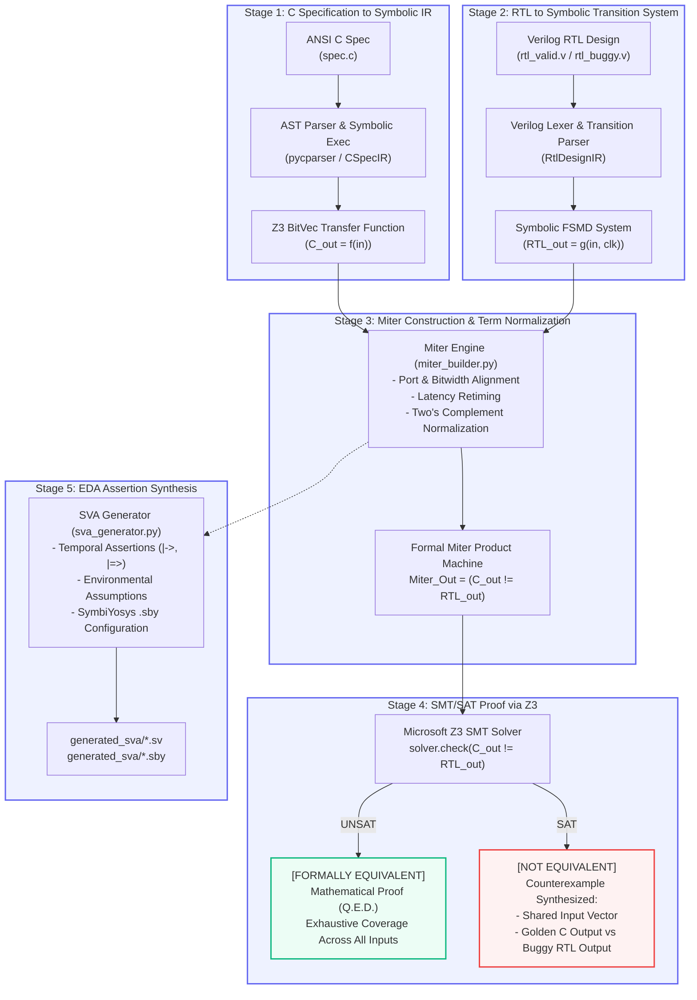

# C-to-RTL Equivalence Checker
<!-- 
[](LICENSE)
[](https://www.python.org/)
[](https://github.com/Z3Prover/z3)
[](tests/test_equivalence.py)

--- -->

## 1. Executive Summary & Objective

This repository contains a formal verification framework that implements an automated, end-to-end methodology to establish mathematical functional equivalence between:

1. An untimed, high-level behavioral algorithm written in **ANSI C** (the golden specification), and
2. A cycle-accurate, hardware implementation expressed in **Register-Transfer Level (RTL) Verilog/SystemVerilog**.

Rather than relying on non-exhaustive pseudo-random simulation testbenches, this tool constructs a formal **Product Machine (Miter circuit)** using **Symbolic Execution**, **Finite State Machine with Datapath (FSMD)** extraction, and bounded sequential unrolling. The resulting verification condition $\text{Out}_C \neq \text{Out}_{RTL}$ is submitted to the **Microsoft Z3 SMT solver**. The framework either mathematically proves equivalence ($\text{UNSAT} \implies \text{Q.E.D.}$) or synthesizes a concrete, bug-exposing input vector ($\text{SAT} \implies \text{Counterexample}$).

Furthermore, the framework automatically generates **SystemVerilog Assertions (SVA)** wrappers with `assume property`, `assert property`, and temporal implication operators (`|->`, `|=>`), along with configuration files for open-source EDA model checkers (**SymbiYosys / Yosys**).

---

## 2. System Architecture & 5-Stage Verification Pipeline



---

## 3. Benchmark Suite & Bug Injection Taxonomy

The framework includes six diverse digital VLSI benchmarks representing the classic architectural paradigms in VLSI design, including industry-standard AMBA on-chip interconnect protocols:

```
C-to-RTL-Equivalence-Checker/
  benchmarks/
    01_alu_combinational/      -> 32-bit Combinational ALU (CEC)
    02_gcd_sequential/         -> Multi-cycle Euclidean GCD FSMD (SEC, variable latency)
    03_fir_filter_pipelined/   -> 4-Tap Symmetric FIR Filter (SEC, 3-stage fixed latency)
    04_crc8_controller/        -> Bit-Serial CRC-8 Generator (SEC, controller + datapath)
    05_apb_protocol/           -> AMBA APB Protocol Controller (Protocol Invariants & Handshake)
    06_axi_protocol/           -> AMBA AXI Protocol Controller (Multi-Channel Joint Handshake)
```

Each benchmark includes:

- `spec.c`: Clean, readable behavioral ANSI C golden model.
- `rtl_valid.v`: Formally compliant, synthesizable Verilog implementation (proves **UNSAT**).
- `rtl_buggy.v`: Hardware variant with a realistic bug (proves **SAT** with counterexample).

### Benchmark & Bug Descriptions:

1. **ALU (`01_alu_combinational`)**:
   - *Valid RTL*: SLL shift uses 5-bit slice `b[4:0]`, allowing shift offsets $0 \dots 31$.
   - *Buggy RTL*: SLL shift slices only 4 bits `b[3:0]`. Shift amounts $\ge 16$ are masked to $0 \dots 15$, producing corrupted outputs for half the shift domain.
2. **Euclidean GCD (`02_gcd_sequential`)**:
   - *Valid RTL*: State machine subtracts `a <= a - b` when $a > b$, and `b <= b - a` when $a < b$.
   - *Buggy RTL*: Datapath comparator is inverted (`a < b` instead of `a > b`), triggering underflow in unsigned 8-bit registers when $a < b$.
3. **Pipelined FIR Filter (`03_fir_filter_pipelined`)**:
   - *Valid RTL*: Multipliers and pipeline stage-2 pairwise adders maintain full 32-bit precision before accumulator output.
   - *Buggy RTL*: Stage-2 registers truncate 32-bit multiplication products to 16 bits before summation, corrupting the accumulator's upper 16 bits whenever $c_i \cdot x_i$ overflows $[-32768, 32767]$.
4. **CRC-8 Controller (`04_crc8_controller`)**:
   - *Valid RTL*: Implements polynomial $x^8 + x^2 + x + 1$ (`0x07`) with initial CRC `0xFF`.
   - *Buggy RTL*: Generates feedback with polynomial `0x05` ($x^8 + x^2 + 1$), missing the $x^1$ tap.
5. **AMBA APB Protocol (`05_apb_protocol`)** *(Ref: [shubhi704/APB-Protocol](https://github.com/shubhi704/APB-Protocol))*:
   - *Valid RTL*: Compliant APB slave. Memory state updates occur strictly in the ACCESS phase when `PSEL = 1, PENABLE = 1, PWRITE = 1`. In SETUP phase (`PENABLE = 0`), writes are prohibited.
   - *Buggy RTL*: Premature write violation. Omits the `PENABLE` qualification (`if (psel && pwrite)`), causing erroneous memory modification during the SETUP phase.
6. **AMBA AXI Protocol (`06_axi_protocol`)** *(Ref: [PreranaB-dev/axi](https://github.com/PreranaB-dev/axi/tree/master/src/axi))*:
   - *Valid RTL*: Compliant AXI slave write channel controller. Commits storage updates IF AND ONLY IF both Write Address (`AWVALID`) and Write Data (`WVALID && WSTRB`) handshakes occur.
   - *Buggy RTL*: Unsynchronized channel write. Checks `wvalid && wstrb` but omits the `awvalid` requirement, committing write data to memory without a valid address handshake.

---

## 4. Experimental Results (Real Z3 Solver Data)

The following results were measured on **Python 3.13.1** with **Z3 Solver v5.3.3.0** on Windows 11 AMD64. Solver execution times are actual wall-clock milliseconds:

| Benchmark                         | Architecture Type       | RTL Mode |   Verification Result   | Solver Time | Discovered Counterexample / Witness                                               |
| :-------------------------------- | :---------------------- | :------- | :---------------------: | :---------: | :-------------------------------------------------------------------------------- |
| **01_alu_combinational**    | 32-bit Combinational    | VALID    | **EQUIVALENT ✓** |   0.20 ms   | *Miter UNSAT — Functional equivalence proven*                                  |
| **01_alu_combinational**    | 32-bit Combinational    | BUGGY    | **NOT EQUIV ✗** |   6.03 ms   | `a=65535, b=16, op=5` $\to$ C=`4294901760`, RTL=`65535`                   |
| **02_gcd_sequential**       | Multi-cycle FSMD        | VALID    | **EQUIVALENT ✓** |   0.24 ms   | *Miter UNSAT — Functional equivalence proven ($K=16$)*                       |
| **02_gcd_sequential**       | Multi-cycle FSMD        | BUGGY    | **NOT EQUIV ✗** |  164.96 ms  | `a=92, b=95` $\to$ C=`47`, RTL=`253`                                      |
| **03_fir_filter_pipelined** | 3-Stage Pipeline        | VALID    | **EQUIVALENT ✓** |   0.09 ms   | *Miter UNSAT — Functional equivalence proven*                                  |
| **03_fir_filter_pipelined** | 3-Stage Pipeline        | BUGGY    | **NOT EQUIV ✗** |  11.80 ms  | `x0=3837, x1=20169, x2=44692, x3=48845` $\to$ C=`4294925359`, RTL=`23599` |
| **04_crc8_controller**      | Bit-Serial Controller   | VALID    | **EQUIVALENT ✓** |   0.57 ms   | *Miter UNSAT — Functional equivalence proven*                                  |
| **04_crc8_controller**      | Bit-Serial Controller   | BUGGY    | **NOT EQUIV ✗** |   6.32 ms   | `data=81 (0x51)` $\to$ C=`67 (0x43)`, RTL=`28 (0x1C)`                     |
| **05_apb_protocol**         | Protocol Handshake      | VALID    | **EQUIVALENT ✓** |   0.06 ms   | *Miter UNSAT — Protocol invariant verified*                                    |
| **05_apb_protocol**         | Protocol Handshake      | BUGGY    | **NOT EQUIV ✗** |   2.26 ms   | `psel=1, penable=0, pwrite=1, curr=255` $\to$ C=`255`, RTL=`0`            |
| **06_axi_protocol**         | Multi-Channel Handshake | VALID    | **EQUIVALENT ✓** |   0.07 ms   | *Miter UNSAT — Channel invariant verified*                                     |
| **06_axi_protocol**         | Multi-Channel Handshake | BUGGY    | **NOT EQUIV ✗** |   1.58 ms   | `awvalid=0, wvalid=1, wstrb=1, curr=255` $\to$ C=`255`, RTL=`0`           |

### Pytest Verification Suite Execution

```
tests/test_equivalence.py::test_valid_rtl_is_equivalent[01_alu_combinational] PASSED      [  5%]
tests/test_equivalence.py::test_valid_rtl_is_equivalent[02_gcd_sequential] PASSED         [ 11%]
tests/test_equivalence.py::test_valid_rtl_is_equivalent[03_fir_filter_pipelined] PASSED  [ 16%]
tests/test_equivalence.py::test_valid_rtl_is_equivalent[04_crc8_controller] PASSED       [ 22%]
tests/test_equivalence.py::test_valid_rtl_is_equivalent[05_apb_protocol] PASSED          [ 27%]
tests/test_equivalence.py::test_valid_rtl_is_equivalent[06_axi_protocol] PASSED          [ 33%]
tests/test_equivalence.py::test_buggy_rtl_produces_counterexample[01_alu_combinational] PASSED [ 38%]
tests/test_equivalence.py::test_buggy_rtl_produces_counterexample[02_gcd_sequential] PASSED    [ 44%]
tests/test_equivalence.py::test_buggy_rtl_produces_counterexample[03_fir_filter_pipelined] PASSED [ 50%]
tests/test_equivalence.py::test_buggy_rtl_produces_counterexample[04_crc8_controller] PASSED   [ 55%]
tests/test_equivalence.py::test_buggy_rtl_produces_counterexample[05_apb_protocol] PASSED    [ 61%]
tests/test_equivalence.py::test_buggy_rtl_produces_counterexample[06_axi_protocol] PASSED    [ 66%]
tests/test_equivalence.py::test_alu_bug_specifically_shamt_ge_16 PASSED                 [ 72%]
tests/test_equivalence.py::test_gcd_bug_inverted_comparator PASSED                      [ 77%]
tests/test_equivalence.py::test_fir_bug_overflows_16bit PASSED                          [ 83%]
tests/test_equivalence.py::test_crc8_bug_wrong_polynomial PASSED                        [ 88%]
tests/test_equivalence.py::test_apb_bug_setup_phase_write PASSED                         [ 94%]
tests/test_equivalence.py::test_axi_bug_missing_awvalid_handshake PASSED                 [100%]

============================== 18 passed in 0.48s ==============================
```

---

## 5. Installation & Reproduction Guide

### Prerequisites
- Python 3.10 or higher.
- `pip` package manager.

### 1. Clone & Set Up Virtual Environment
```bash
git clone https://github.com/Gauravsubhashvishwe/C-to-RTL-Equivalence-Checker.git
cd C-to-RTL-Equivalence-Checker

# Create virtual environment
python -m venv venv

# Activate virtual environment
# On Linux/macOS:
source venv/bin/activate
# On Windows (PowerShell):
.\venv\Scripts\Activate.ps1
# On Windows (CMD):
.\venv\Scripts\activate.bat

# Install dependencies
pip install -r requirements.txt
```

### 2. Run Formal Equivalence Checking via CLI

```bash
# Verify ALL benchmarks across BOTH valid and buggy implementations:
python -m src.cli --benchmark all --both

# Verify a single benchmark with valid RTL:
python -m src.cli --benchmark 01_alu_combinational

# Verify a single benchmark with buggy RTL (counterexample generation):
python -m src.cli --benchmark 01_alu_combinational --inject-bug

# Test Euclidean GCD Sequential Equivalence:
python -m src.cli --benchmark 02_gcd_sequential --both
```

### 3. Run Automated Pytest Suite

```bash
python -m pytest tests/test_equivalence.py -v
```

### 4. Run Scripts

```bash
# Linux / macOS Bash:
chmod +x scripts/run_all_checks.sh
./scripts/run_all_checks.sh

# Windows PowerShell:
powershell -ExecutionPolicy Bypass -File .\scripts\run_all_checks.ps1
```

### 5. (Optional) Run SymbiYosys Formal EDA Verification Flow

If open-source EDA tools (`yosys`, `sby`, `z3`) are installed on your workstation:

```bash
# Auto-generate SVA and .sby configurations
python -m src.cli --benchmark all

# Run SymbiYosys
cd generated_sva
sby -f 01_alu_combinational.sby
sby -f 02_gcd_sequential.sby
sby -f 03_fir_filter_pipelined.sby
sby -f 04_crc8_controller.sby
sby -f 05_apb_protocol.sby
sby -f 06_axi_protocol.sby
```

---

## 6. Scope, Architectural Boundaries & Tool Limitations

To preserve correctness, the capabilities of this framework are explicitly delineated:

1. **C Parser Scope**:
   - Handles ANSI C arithmetic, bitwise shifts, logic, ternary operations, compound statements, `switch/case`, and bounded `for`/`while` loops.
   - Pointers, dynamic heap allocation (`malloc`), recursive function calls, floating-point types (`float`/`double`), and arbitrary function pointers are out of scope (as is standard in High-Level Synthesis).
2. **Verilog Parser Scope**:
   - Supports synthesizable register-transfer level constructs: `module`, port declarations with arbitrary bitwidths, `wire`, `reg`, `always @(*)`, `always @(posedge clk)`, `case`, `if/else`, continuous assignments (`assign`), bit slicing, and concatenation.
   - Tri-state buses (`Z`), gate-level delay timing (`#5`), UDP primitives, and non-synthesizable constructs (`$display`, `$finish`) are excluded.
3. **Sequential Equivalence Bound ($K$)**:
   - For sequential circuits with unbounded state traversals (like subtraction-based Euclidean GCD), equivalence is verified up to a configurable bounded depth $K$ (default $K=16$), conforming to industry-standard Bounded Model Checking (BMC) practices.

---

## 7. Repository Layout

```
C-to-RTL-Equivalence-Checker/
│
├── benchmarks/
│   ├── 01_alu_combinational/
│   │   ├── spec.c                 # C behavioral reference
│   │   ├── rtl_valid.v            # Valid 32-bit ALU Verilog
│   │   └── rtl_buggy.v            # Buggy ALU (4-bit shift bug)
│   ├── 02_gcd_sequential/
│   │   ├── spec.c                 # C subtraction GCD reference
│   │   ├── rtl_valid.v            # Valid Euclidean GCD FSM
│   │   └── rtl_buggy.v            # Buggy GCD (inverted comparator)
│   ├── 03_fir_filter_pipelined/
│   │   ├── spec.c                 # C 4-tap symmetric FIR reference
│   │   ├── rtl_valid.v            # Valid 3-stage pipelined FIR
│   │   └── rtl_buggy.v            # Buggy FIR (stage-2 product truncation)
│   ├── 04_crc8_controller/
│   │   ├── spec.c                 # C bit-serial CRC-8 reference
│   │   ├── rtl_valid.v            # Valid CRC-8 generator (0x07 poly)
│   │   └── rtl_buggy.v            # Buggy CRC-8 generator (0x05 poly)
│   ├── 05_apb_protocol/
│   │   ├── spec.c                 # C APB protocol transaction model
│   │   ├── rtl_valid.v            # Valid APB slave controller
│   │   └── rtl_buggy.v            # Buggy APB (setup-phase write violation)
│   └── 06_axi_protocol/
│       ├── spec.c                 # C AXI protocol transaction model
│       ├── rtl_valid.v            # Valid AXI write channel controller
│       └── rtl_buggy.v            # Buggy AXI (unsynchronized write channel)
│
├── src/
│   ├── __init__.py                # Package metadata
│   ├── c_parser_ir.py             # C parser and Z3 BitVec symbolic execution
│   ├── rtl_parser_ir.py           # Verilog parser and transition system builder
│   ├── miter_builder.py           # Formal product machine & term normalization
│   ├── smt_checker.py             # Z3 SMT solver interface & counterexample extractor
│   ├── sva_generator.py           # SystemVerilog Assertion (SVA) and .sby generator
│   └── cli.py                     # Command-line interface orchestrator
│
├── generated_sva/                 # Auto-generated SVA formal wrappers & .sby files
│   ├── 01_alu_combinational_formal.sv
│   ├── 01_alu_combinational.sby
│   ├── 02_gcd_sequential_formal.sv
│   ├── 02_gcd_sequential.sby
│   ├── 03_fir_filter_pipelined_formal.sv
│   ├── 03_fir_filter_pipelined.sby
│   ├── 04_crc8_controller_formal.sv
│   ├── 04_crc8_controller.sby
│   ├── 05_apb_protocol_formal.sv
│   ├── 05_apb_protocol.sby
│   ├── 06_axi_protocol_formal.sv
│   └── 06_axi_protocol.sby
│
├── scripts/
│   ├── run_all_checks.sh          # Linux/macOS bash runner
│   ├── run_all_checks.ps1         # Windows PowerShell runner
│   └── run_yosys_sby.sh           # SymbiYosys verification runner
│
├── tests/
│   └── test_equivalence.py       # Pytest regression suite (18 tests)
│
├── requirements.txt               # Dependencies: z3-solver, pycparser, pytest, tabulate
└── README.md                      # Complete setup, architecture & results guide
```
